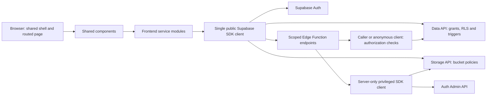

# MiniMarket architecture

This describes the implemented application, not a plan. The canonical feature/setup guide is [README.md](README.md); database relationships are in [supabase/README.md](supabase/README.md). The source uses one Vite SPA, a Supabase backend and three server-side Edge Functions.

## Request flow

The browser receives only the project URL and publishable key, plus SDK-managed session tokens after login. Normal table reads/writes go through RLS. Privileged credentials stay in server processes; they are never bundled with Vite. CORS limits browser origins but does not replace authorization.

## Shell, navigation and state

- `index.html` contains the app shell. `src/main.js` initializes Bootstrap/styles, toast feedback, header/footer, Auth state and router.
- `src/router.js` is the single History API router. Static Add precedes dynamic details. It handles route guards, safe login return URLs, page titles/focus, Back/Forward, direct routes and unmount cleanup. Netlify's rewrite supports deep links.
- Each `src/pages/<page>/` folder has JavaScript, an HTML fragment and CSS. HTML fragments do not include document-level elements. Page mounts return cleanup functions; optional `canLeave` and `updateLocation` hooks support dirty forms and query-only filtering.
- `auth-state.js` stores the verified current user/profile in memory, initializes from the SDK session, and reacts to Auth events outside the SDK callback lock. Revision counters ignore stale responses. Current roles come from `user_roles`, not metadata or `profiles.role`.
- The header uses the verified profile name, conditional visitor/member/admin links, active-route indication and hover/focus feedback. The responsive menu and component subscriptions are disposed on teardown.

## Reusable UI and service boundaries

| Module area | Responsibility |
| --- | --- |
| `listing-card`, `listing-thumbnail` | Public cards and table images, safe URLs, fallback placeholders, shared cover priority and illustrative-photo credits |
| `listing-details` | Shared gallery, description, price, seller contacts, favorite button and owner edit/delete controls |
| `listing-form` | Validated Add/Edit fields, pending/saved attachments, failed-save retention and dirty-state protection |
| `listing-modals` | Reusable form/view/delete dialogs for listing-management views, focus handling and confirmations |
| `listing-attachments` | File selection feedback, previews, signed delivery, removal, retry and the combined five-file limit |
| `admin-shell`, `admin-dialog` | Admin navigation, tabular management, pagers and shared account/category dialogs |
| `toast-service`, `operation-feedback` | Curated success/error/info feedback; mutation services publish events without rendering UI |
| `listings-service`, `categories-service`, `favorites-service`, `dashboard-service` | Queries, pagination, caller scoping and ordinary marketplace mutations |
| `auth-service`, `auth-state`, `service-helpers` | Auth API, verified identity/role, session lifecycle and shared caller/query helpers |
| `attachment-service`, `listing-images-service`, `listing-owner-service`, `admin-service` | Existing Storage paths, signed URLs, seller endpoint and guarded admin APIs |
| `utils/` | Validation, safe image URLs, formatting, filters, file upload helper, modal focus and unsaved-change guards |

Dynamic user content is rendered with DOM text APIs. Bootstrap provides layout, forms, collapses and dialogs. Current public cards link to `/listings/:id`; they do not require a separate details implementation depending on the source page.

## Data loading and synchronization

Home independently loads categories and eight latest listings. Browse loads all public listings/categories once per mount, then applies case-insensitive title search on every character, category and sort locally. Query-only navigation preserves loaded data and input focus; live typing replaces the current query history entry. Clearing filters restores the full loaded set. Reloading/revisiting fetches current server data. Admin tables use server query pagination; user searches are handled by the server-only Auth directory path.

Favorite controls make one caller-scoped ID read per mounted view and update matching buttons through a window-local `minimarket:favorites-changed` event. Successful listing/admin mutations reload their affected table. Dashboard reads personal counts when mounted; it does not subscribe to database changes.

There are **no Supabase Realtime channels, `postgres_changes` listeners or published application tables** in the inspected implementation. SDK Auth state events support session/tab synchronization; local state listeners and DOM events are not a database subscription. Other sessions' edits and role changes are not pushed into the displayed page. RLS and each privileged request still validate current access. Adding database Realtime would be a separate feature with its own publication, access and cleanup design.

## Backend authorization and deletion

The six public tables and three private cleanup tables have RLS enabled. `auth.users` is managed by Supabase; `profiles.id` and `user_roles.user_id` each reference an Auth user. Listings and favorites also reference Auth users directly. `user_roles.role` is authoritative (`user`/`admin`), with a trigger-maintained profile mirror. New accounts start as users regardless of editable metadata.

Public wrappers such as `admin_set_role`, `admin_overview`, `admin_user_summaries`, `admin_user_impact`, `admin_begin_user_deletion`, `begin_listing_deletion` and `begin_attachment_deletion` delegate to existing private implementations. They are not permission-free bypasses: private code checks identity, ownership/current role and cleanup state, and uses fixed search paths. Last-admin protection is serialized in the database. Ordinary clients cannot edit private reservation rows.

`minimarket-admin` verifies the token and current role before server-side Auth user operations. Its listing cleanup action also supports the verified owner. `listing-owner` derives an owner from a public listing and returns only name/email. `listing-attachment-urls` derives paths from publicly visible attachment metadata before signing; callers cannot ask it to sign an arbitrary path.

Storage deletion precedes listing or Auth deletion. Private user/listing/attachment reservations block conflicting writes and let a failed cleanup be retried. The database cascade removes dependent application rows after successful cleanup. Storage files must be removed through the Storage API rather than SQL metadata deletion.

## Image pipeline

`listing-attachments` is private; user images and PDFs are associated through `listing_attachments`, with five combined attachments and 5 MB per file. Storage policies and metadata triggers enforce the server boundary. Signed read/download URLs expire after 300 seconds; clients batch and refresh them. The public `listing-images` bucket remains for legacy/populated covers stored in `listings.image_url`.

Lists use the first image attachment by creation time/ID, then the public cover, then a category placeholder. The shared details component resolves attachments before revealing the content to avoid flashing a different cover. Galleries center their secondary images and preserve the main photo's proportions. The server-only product-image population script reuses upload validation, skips existing photos, pins reviewed source bytes and preserves attribution in a frontend manifest and Storage metadata.

## Maintenance and deployment

Schema changes are versioned in `supabase/migrations/`; Edge entrypoints/config are under `supabase/functions/` and `supabase/config.toml`. Node maintenance scripts use ignored server credentials, never `VITE_` secrets. The demo seed and maintenance/Edge guards target the confirmed project intentionally. Git tracks source, migrations, licensing records and the npm lockfile; local secrets, generated builds, downloaded photos and maintenance journals are ignored.

Netlify builds the frontend with `npm run build` and publishes `dist/`. Supabase hosts the database, Auth, Storage and Edge Functions separately; deploying a frontend build does not deploy SQL or functions. See README for verified package commands and the explicit migration/deployment workflow. No deployment is required to generate or review documentation.
