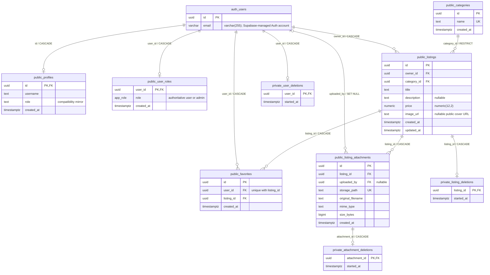

# MiniMarket database and security

Schema and relationships below were checked against the connected MiniMarket project `kkcfqkwkdcqvnurbdxus` and the five SQL migrations on 9 November 2026. The project contains six public application tables and three private cleanup-reservation tables. Supabase manages Auth and Storage schemas separately.

## Entity relationship diagram

Names such as `public_listings` are diagram aliases for `public.listings`; they are not extra database tables. Only selected columns of Supabase-managed `auth.users` are shown. Every relationship line represents an actual foreign key. Optional profile/role cardinality describes the constraint; the signup trigger normally provisions both rows.

`profiles`, listing owners, favorite users and attachment uploaders are linked by the same Auth UUID; there is **no foreign key from a listing/favorite to `profiles`**. The administrator view joins profile names through service code. The `(user_id, listing_id)` unique constraint prevents duplicate favorites. Category names and attachment paths are unique. Prices are nonnegative `numeric(12,2)`; zero is allowed. Categories do not have descriptions, images, parent IDs or status fields.

The nullable `uploaded_by` reference uses `ON DELETE SET NULL`; the remaining account-owned application rows use cascades. Category deletion is restricted while listings reference it. Cleanup reservations have one row at most per target and cascade away with that target.

## Storage references are not foreign keys

`listings.image_url` is a public cover URL into the existing `listing-images` bucket. `listing_attachments.storage_path` identifies an object in the existing private `listing-attachments` bucket. Neither column has a foreign key to `storage.objects`; integrity and cleanup are enforced by functions/triggers and Storage API operations. The ER diagram deliberately does not draw a nonexistent Storage FK.

Both buckets enforce 5 MB per file. Public covers accept JPEG, PNG and WebP. Private attachments also accept PDF. A listing may have five attachment metadata rows total, combining images and PDFs. Public cover objects are a separate legacy/maintenance path; user uploads in the shared form use private attachments. Private listing attachments are delivered to visitors through the scoped `listing-attachment-urls` function, not unrestricted Storage SELECT.

## Tables and access rules

All nine application/private tables shown in the diagram have RLS enabled. Table/column grants work alongside these policies.

| Table | Read boundary | Write boundary |
| --- | --- | --- |
| `public.profiles` | Own profile or admin | Own username only through client column grants; no direct client INSERT/DELETE or role updates |
| `public.user_roles` | Own active assignment or admin | Trusted signup/server maintenance and authorized admin role RPC; no direct browser writes |
| `public.categories` | Public | Admin only; FK blocks deletion when used |
| `public.listings` | Public | Active owner/admin; owners cannot be reassigned; cleanup reservations block conflicting writes |
| `public.favorites` | Saving user only, including for admins | Own INSERT/DELETE; no UPDATE |
| `public.listing_attachments` | Metadata for publicly readable parent listings | Parent owner/admin INSERT/DELETE; no UPDATE; validated real file metadata and total count |
| `private.user_deletions` | No ordinary client access | Guarded server cleanup workflow |
| `private.listing_deletions` | No ordinary client access | Guarded server cleanup workflow |
| `private.attachment_deletions` | No ordinary client access | Guarded server cleanup workflow |

`public.app_role` is an enum with `user` and `admin`. Signup uses `private.handle_new_user` to create a profile and regular role, ignoring any metadata role claim. `private.is_admin` checks authoritative `user_roles` and pending user deletion state. `private.mirror_role` maintains `profiles.role`; `private.guard_role_change` protects the last active administrator. Application code also uses current role queries for admin actions, rather than trusting a stale role claim alone.

## Existing RPC and trigger boundaries

The following public functions exist: `admin_overview`, `admin_user_summaries`, `admin_user_impact`, `admin_begin_user_deletion`, `admin_set_role`, `begin_listing_deletion`, `begin_attachment_deletion`. They are invoker wrappers around private implementations with explicit current-user/admin/owner checks; the `private` schema must remain outside the exposed Data API schemas. Elevated private functions have fixed search paths and restricted grants. Frontend guards alone do not authorize access.

Other existing private helpers include `set_listing_updated_at`, `guard_listing_integrity`, `validate_listing_attachment`, `lock_attachment_listing`, `can_manage_listing_attachments` and file-cleanup guards. They maintain timestamps, immutable owners, valid uploaded cover paths, authoritative attachment metadata, serialized attachment limits and deletion ordering. No new table or function is proposed by this documentation.

Storage policies check bucket/path and parent listing management rights. A normal client cannot overwrite uploaded attachment objects. Cleanup uses Storage API removal before deleting metadata/listings/accounts; the database rejects premature deletion while related files remain. Server-only Auth operations live in [minimarket-admin](functions/minimarket-admin/), with per-request token and current-role checks. Seller contact disclosure and scoped attachment signing use separate public endpoints described in the [root README](../README.md).

## Migration history and workflow

| Version | File | Applied behavior |
| --- | --- | --- |
| `20261108082659` | [initial_minimarket_schema](migrations/20261108082659_initial_minimarket_schema.sql) | Profiles, categories, listings, favorites, constraints, initial grants/RLS and triggers |
| `20261108163728` | [admin_roles_panel](migrations/20261108163728_admin_roles_panel.sql) | Authoritative roles, user/listing cleanup state, public cover bucket, admin RPCs and integrity guards |
| `20261108164837` | [admin_rpc_hardening](migrations/20261108164837_admin_rpc_hardening.sql) | Moves elevated RPC implementations into private schema; restricted public wrappers and cleanup state |
| `20261108224311` | [listing_attachments](migrations/20261108224311_listing_attachments.sql) | Attachment metadata, private bucket, attachment cleanup state, policies and validation |
| `20261109085900` | [listing_attachment_total_limit](migrations/20261109085900_listing_attachment_total_limit.sql) | Combined maximum of five attachments per listing |

All five are applied to the connected project and synchronized from `supabase_migrations.schema_migrations`. Do not rerun or alter them. Use a new CLI-created migration for a future schema change. Test against a disposable/local Supabase stack, review RLS/grants and cleanup behavior, then deliberately target the correct hosted project. CLI 3 defaults to local; the verified create/apply/list/fetch commands are in the [root workflow](../README.md#database-migration-workflow). Fetching history recovers stored SQL; it does not generate a schema diff or migrate the database.

The original `scripts/verify-database.sql` only targets the initial disposable schema and should not be run against the current populated project. Current live verification scripts use supported Auth Admin temporary fixtures and Storage cleanup; check their individual setup requirements. [bootstrap-admin.sql](../scripts/bootstrap-admin.sql) promotes an explicitly selected existing account through a trusted SQL connection for initial setup; it is not a browser API.

## Realtime status

The inspected `pg_publication_tables` result contains no published tables, and frontend code creates no Supabase Realtime channels or Postgres-change subscriptions. Auth state events and current-window favorite events are implemented; database push synchronization is not. See [synchronization behavior](../README.md#synchronization-and-realtime) before planning any Realtime extension.

Operational detail: [administration](ADMIN.md), [attachments](ATTACHMENTS.md), [seed](../scripts/SEED.md), [cover population/licensing](../scripts/IMAGE_POPULATION.md).
